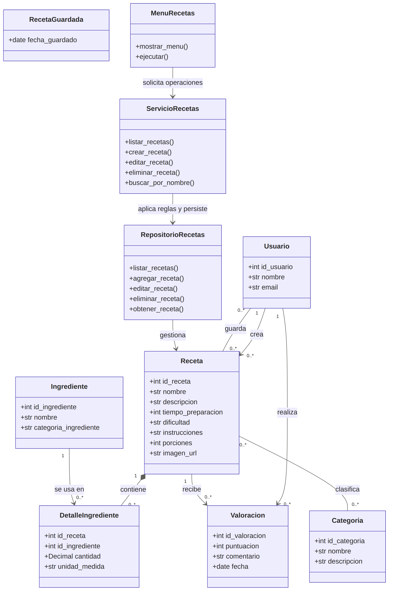

# Diagrama UML - Arquitectura de clases

El diagrama presenta las entidades persistentes, las relaciones ORM, la lógica de negocio, los repositorios y las interfaces de consola y web de la aplicación.

```mermaid
classDiagram
    direction LR

    namespace Acceso_a_Datos {
        class DatabaseProxy {
            <<Peewee>>
            +initialize(database)
            +connection_context()
            +atomic()
            +close()
        }

        class ModelBase {
            <<abstract>>
            +Meta.database
        }

        class Usuario {
            +AutoField id_usuario
            +CharField nombre
            +CharField email
            +CharField password_hash
            +BooleanField activo
            +__str__() str
        }

        class Receta {
            +AutoField id_receta
            +CharField nombre
            +TextField descripcion
            +IntegerField tiempo_preparacion
            +CharField dificultad
            +TextField instrucciones
            +IntegerField porciones
            +CharField imagen_url
            +ForeignKeyField usuario
            +__str__() str
        }

        class Categoria {
            +AutoField id_categoria
            +CharField nombre
            +CharField descripcion
            +__str__() str
        }

        class Ingrediente {
            +AutoField id_ingrediente
            +CharField nombre
            +CharField categoria_ingrediente
            +__str__() str
        }

        class DetalleIngrediente {
            +ForeignKeyField receta
            +ForeignKeyField ingrediente
            +DecimalField cantidad
            +CharField unidad_medida
        }

        class RecetaCategoria {
            +ForeignKeyField receta
            +ForeignKeyField categoria
        }

        class Valoracion {
            +AutoField id_valoracion
            +SmallIntegerField puntuacion
            +TextField comentario
            +DateField fecha
            +ForeignKeyField usuario
            +ForeignKeyField receta
        }

        class RecetaGuardada {
            +ForeignKeyField usuario
            +ForeignKeyField receta
            +DateField fecha_guardado
        }

        class UsuarioRepo {
            <<module>>
            +guardar_usuario()
            +listar_usuarios()
            +buscar_usuario_por_id()
            +buscar_usuario_por_email()
            +buscar_usuarios_por_nombre()
            +cambiar_estado_usuario()
            +eliminar_usuario()
        }

        class RecetaRepo {
            <<module>>
            +guardar_receta()
            +listar_recetas()
            +buscar_receta_por_id()
            +buscar_recetas_por_nombre()
            +buscar_recetas_por_categoria()
            +buscar_recetas_por_usuario()
            +eliminar_receta()
            +guardar_detalle_ingrediente()
            +obtener_categorias_receta()
            +asignar_categoria_receta()
        }

        class CategoriaRepo {
            <<module>>
            +guardar_categoria()
            +listar_categorias()
            +buscar_categoria_por_id()
            +buscar_categoria_por_nombre()
            +editar_categoria()
            +eliminar_categoria()
        }

        class IngredienteRepo {
            <<module>>
            +guardar_ingrediente()
            +listar_ingredientes()
            +buscar_ingrediente_por_id()
            +buscar_ingrediente_por_nombre()
            +buscar_ingredientes_por_nombre()
            +editar_ingrediente()
            +eliminar_ingrediente()
        }

        class ValoracionRepo {
            <<module>>
            +listar_valoraciones()
            +listar_por_receta()
            +buscar_valoracion_por_id()
            +guardar_valoracion()
            +editar_valoracion()
            +eliminar_valoracion()
        }
    }

    namespace Logica_de_Negocio {
        class ServicioAuth {
            <<module>>
            +asegurar_usuario_inicial()
            +autenticar_usuario()
        }

        class ServicioUsuarios {
            +listar_usuarios()
            +obtener_usuario()
            +buscar_usuarios()
            +crear_usuario()
            +editar_usuario()
            +deshabilitar_usuario()
            +habilitar_usuario()
            +eliminar_usuario()
        }

        class ServicioRecetas {
            +listar_recetas()
            +obtener_receta()
            +buscar_por_nombre()
            +buscar_por_categoria()
            +obtener_ingredientes()
            +obtener_categorias()
            +crear_receta()
            +editar_receta()
            +eliminar_receta()
            +agregar_ingrediente()
            +reemplazar_ingredientes()
            +asignar_categoria()
        }

        class ServicioCategorias {
            +listar_categorias()
            +obtener_categoria()
            +buscar_categorias()
            +crear_categoria()
            +editar_categoria()
            +eliminar_categoria()
        }

        class ServicioIngredientes {
            +listar_ingredientes()
            +obtener_ingrediente()
            +buscar_ingredientes()
            +crear_ingrediente()
            +editar_ingrediente()
            +eliminar_ingrediente()
        }

        class ServicioValoraciones {
            +listar_valoraciones()
            +listar_por_receta()
            +obtener_valoracion()
            +crear_valoracion()
            +editar_valoracion()
            +eliminar_valoracion()
        }
    }

    namespace Presentacion {
        class MenuRecetas {
            +Usuario usuario_actual
            +leer_entrada()
            +leer_entero()
            +ejecutar()
            +_menu_recetas()
            +_menu_categorias()
            +_menu_ingredientes()
            +_menu_usuarios()
            +_menu_valoraciones()
        }

        class Login {
            <<module>>
            +iniciar_login()
        }

        class ManejadorRecetas {
            <<HTTP>>
            +do_GET()
            +do_POST()
            +do_PATCH()
            +do_DELETE()
            +iniciar_servidor()
        }

        class Aplicacion {
            <<main>>
            +main()
        }
    }

    namespace Auxiliares {
        class Seguridad {
            <<module>>
            +hashear_contrasena()
            +verificar_contrasena()
            +pedir_contrasena()
        }

        class Validaciones {
            <<module>>
            +validar_texto()
            +validar_email()
            +validar_entero_positivo()
            +validar_decimal_positivo()
            +validar_dificultad()
        }

        class Configuracion {
            <<module>>
            +variables_de_base_de_datos
            +variables_de_aplicacion
        }

        class Mensajes {
            <<module>>
            +mensajes_de_consola
        }
    }

    ModelBase <|-- Usuario
    ModelBase <|-- Receta
    ModelBase <|-- Categoria
    ModelBase <|-- Ingrediente
    ModelBase <|-- DetalleIngrediente
    ModelBase <|-- RecetaCategoria
    ModelBase <|-- Valoracion
    ModelBase <|-- RecetaGuardada
    DatabaseProxy -- ModelBase : configura

    Usuario "1" --> "0..*" Receta : crea
    Receta "1" *-- "0..*" DetalleIngrediente : posee
    Ingrediente "1" --> "0..*" DetalleIngrediente : se utiliza en
    Receta "1" --> "0..*" RecetaCategoria : tiene
    Categoria "1" --> "0..*" RecetaCategoria : clasifica
    Usuario "1" --> "0..*" Valoracion : escribe
    Receta "1" --> "0..*" Valoracion : recibe
    Usuario "1" --> "0..*" RecetaGuardada : guarda
    Receta "1" --> "0..*" RecetaGuardada : es guardada

    DetalleIngrediente ..> RecetaRepo : se consulta y modifica
    RecetaCategoria ..> RecetaRepo : se consulta y modifica
    UsuarioRepo --> Usuario : persiste
    RecetaRepo --> Receta : persiste
    RecetaRepo --> DetalleIngrediente : persiste
    RecetaRepo --> RecetaCategoria : persiste
    CategoriaRepo --> Categoria : persiste
    IngredienteRepo --> Ingrediente : persiste
    ValoracionRepo --> Valoracion : persiste

    ServicioAuth --> UsuarioRepo : consulta/crea
    ServicioAuth --> Seguridad : usa
    ServicioAuth --> Validaciones : usa
    ServicioUsuarios --> UsuarioRepo : usa
    ServicioRecetas --> RecetaRepo : usa
    ServicioRecetas --> UsuarioRepo : usa
    ServicioRecetas --> CategoriaRepo : usa
    ServicioRecetas --> IngredienteRepo : usa
    ServicioCategorias --> CategoriaRepo : usa
    ServicioIngredientes --> IngredienteRepo : usa
    ServicioValoraciones --> ValoracionRepo : usa
    ServicioValoraciones --> UsuarioRepo : usa
    ServicioValoraciones --> RecetaRepo : usa

    Aplicacion --> Login : inicia
    Aplicacion --> MenuRecetas : crea
    Aplicacion --> DatabaseProxy : verifica/cierra
    Login --> ServicioAuth : autentica
    MenuRecetas --> Usuario : usuario actual
    MenuRecetas --> ServicioRecetas : usa
    MenuRecetas --> ServicioCategorias : usa
    MenuRecetas --> ServicioIngredientes : usa
    MenuRecetas --> ServicioUsuarios : usa
    MenuRecetas --> ServicioValoraciones : usa
    ManejadorRecetas --> ServicioRecetas : usa
    ManejadorRecetas ..> Auxiliares : configuración
```

## Claves y cardinalidades principales

- `Receta.usuario` es una clave foránea obligatoria hacia `Usuario` con eliminación `RESTRICT`.
- `DetalleIngrediente` usa clave primaria compuesta (`receta`, `ingrediente`) y cantidades decimales.
- `RecetaCategoria` usa clave primaria compuesta (`receta`, `categoria`).
- `RecetaGuardada` usa clave primaria compuesta (`usuario`, `receta`).
- `Valoracion` exige una combinación única de (`usuario`, `receta`) y elimina sus registros en cascada.
- Las relaciones receta-categoría e ingrediente-receta representan asociaciones muchos a muchos mediante tablas intermedias.


